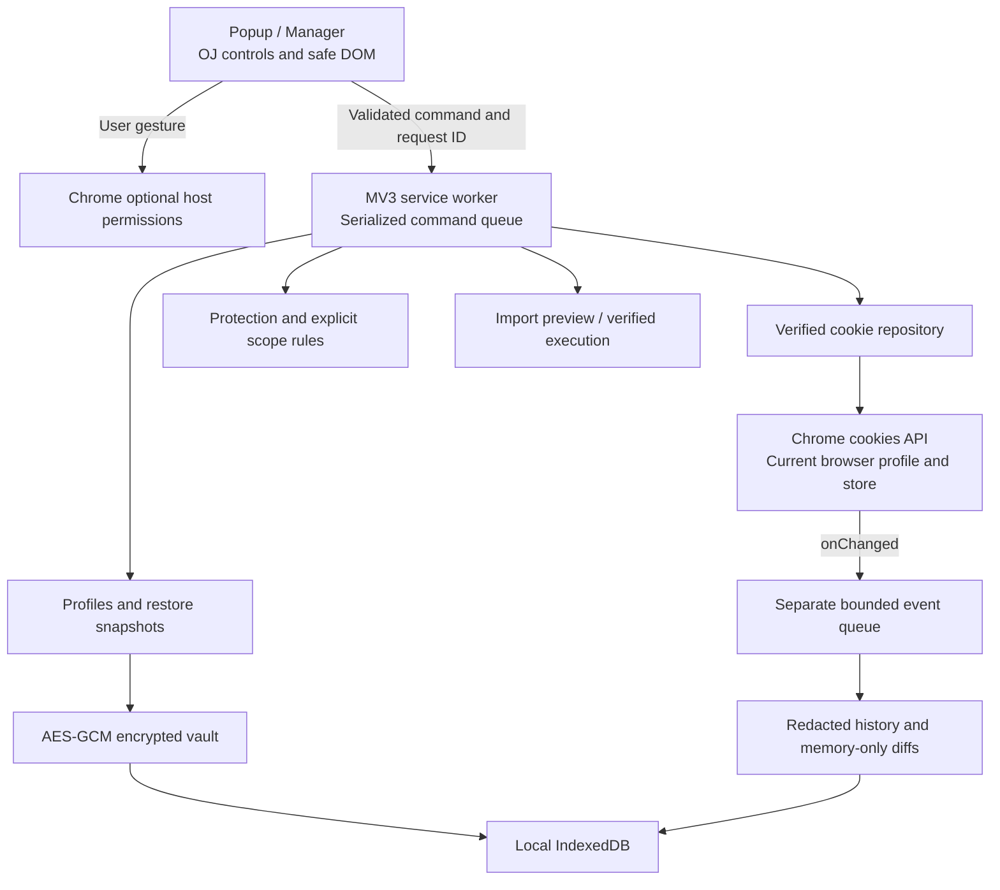

# Architecture

Cookiebase is a local Manifest V3 extension. One vanilla ESM UI entry serves a current-site popup and a standalone manager tab. The manager can target a supplied HTTP(S) URL without opening that website. The workspace navigation is Overview, Cookies, Rules, Profiles, Debug and Settings.

## Components and data flow

| Layer | Source | Responsibility |
| --- | --- | --- |
| UI | [`app.js`](../src/ui/app.js), [`app.css`](../src/ui/app.css) | Mask values, display scopes and coverage, request permissions from the click handler, handle file/clipboard/download actions, show previews and reports. Render cookie pages of 50 rows with debounced search. |
| Cookie model | [`cookies.js`](../src/core/cookies.js) | Normalize cookie identities, validate supported attributes, match scopes, search/filter/sort. `tldts` supplies an offline Public Suffix List, including private suffixes. |
| Chrome adapter | [`repository.js`](../src/core/repository.js), [`permissions.js`](../src/core/permissions.js) | Enumerate stores and reachable partitions; establish regular/incognito context; check grants; write/delete and read back exact identities. |
| Protection | [`rules.js`](../src/core/rules.js) | Any enabled matching allowlist protects a cookie. Domain/name/path wildcards, optional store/partition and site scope are explicit. No hidden deny-rule precedence. Cleanup and imports preserve protection by default. |
| Transfer | [`transfer.js`](../src/services/transfer.js) | Parse JSON/Netscape without mutation; validate and preview every record; restrict Replace; verify each write. See [format contract](FORMATS.md). |
| Profiles | [`profiles.js`](../src/services/profiles.js), [`vault.js`](../src/services/vault.js) | Encrypted profile CRUD, backups, disable/enable snapshots, application preview, verified apply and best-effort rollback. |
| Debug | [`history.js`](../src/services/history.js) | Opt-in observed events, overwrite-pair correlation, retention and memory-only redacted snapshot comparisons. |
| Orchestration | [`worker.js`](../src/worker.js), [`storage.js`](../src/storage.js) | Top-level MV3 listeners, command serialization, bounded event ingestion, value-free recovery journal and local persistence. |

## Identity, scope and verification

An identity is the tuple **name, canonical domain, path, store ID, partition key**. Domain cookies retain a leading dot; HostOnly cookies do not. Partition identity includes the top-level site and cross-site-ancestor flag. Regular/incognito context is established through Chrome stores and their tabs, rather than inferred from a requested store number. Unknown store contexts are withheld until they can be established safely.

Scopes are Current URL, exact Current Host, PSL registrable Site including subdomains, an explicit domain group, or All Accessible Sites. Current URL also respects domain/HostOnly matching, cookie path and Secure transport. All Accessible means the current extension context and actual host grants; it never means another Chrome profile or every hidden partition. Permissions and scope are separate filters.

The adapter requests unpartitioned/API-accessible cookies, a partition wildcard where Chrome supports it, explicit partition context when supplied, and the active top frame's key through feature-detected `getPartitionKey`. Results are deduplicated by full identity. Coverage reports granted origins, actual stores, queried partition keys and limitations.

Every successful `set` is followed by an exact read-back of value and supported attributes. Expiration is compared within one second. Chrome may cap persistence or reject attributes; an adjusted cookie is reported as a verification failure instead of a false success. Deletion is verified absent. For same-name cookies or incomplete grants, exact domain/path expiration avoids deleting a URL-matching sibling through the less-specific `remove(name, url)` API; known sibling identities are checked afterward.

Profile Apply intersects the saved profile scope with the currently chosen scope. Replace only removes within that intersection. Invalid/expired stored cookies abort profile Apply before removals. Import Replace aborts for any invalid/out-of-scope record. The manager sends the preview's expected removal identities; a changed removal set requires another preview. Concurrent website changes during execution are still possible: browser cookie writes are not a transaction.

## Persistence and schema

The initial database is IndexedDB **`cookiebase`, version 1**, with the key/value object store **`records`**. Settings metadata has a separate explicit schema version. Unsupported versions fail with an explanation; the current implementation initializes schema 1 and does not silently reinterpret future formats.

| Location / key | Contents | Persistence |
| --- | --- | --- |
| `chrome.storage.local` / `metadata` | Version 1, protection rules and onboarding acknowledgement | Regular context only; contains no captured cookie values. Domain/rule metadata can still reveal browsing interests. |
| IndexedDB / `vault` | Versioned KDF parameters, salt, IV and authenticated ciphertext containing all profiles and restore snapshots | Encrypted at rest. Profile names, descriptions, tags, scopes, timestamps and cookie values are inside the ciphertext. |
| IndexedDB / `jobs` | Last 30 command IDs/types, state and timestamps; generic recovery messages | No command payload, passphrase, cookie value or result-body persistence. |
| IndexedDB / `history-config` | Debug enabled flag, maximum count and age | Default OFF; 1,000 events / 24 hours. |
| IndexedDB / `history-events` | Cookie names, domains, paths, supported attributes, cause and observation time | Redacted metadata; no cookie values or value fingerprints. |
| Worker memory | Unlocked vault key/plaintext, pending operations, current UI responses, debug comparison HMAC key and snapshots | Lost on worker restart. Never copied into `storage.sync`. |
| Incognito worker memory | Separate records map, rules, jobs, configuration and event data | No persistent extension database or metadata writes. Persistent vaults/profiles/backups are refused. |

Database writes resolve after transaction completion. Quota, policy, blocked-upgrade and unavailable-storage errors reach the UI. There is no `unlimitedStorage` permission. The encrypted vault has a 25 MiB plaintext safety limit; profiles are limited to 200, restore snapshots to the latest 50, and each profile/snapshot to 20,000 cookies. See the separate import-size limits in [FORMATS.md](FORMATS.md).

## MV3 lifecycle and concurrency

Runtime messages, `cookies.onChanged` and installation listeners are registered at worker top level. Production accepts messages only from this extension's own pages. Commands are serialized and a running journal entry is saved before a mutation. A handler returning a per-cookie report can complete with individual failures; inspect that report rather than treating journal completion as universal cookie success.

Closing the popup does not cancel an accepted worker operation. If the worker terminates mid-operation, the next initialization marks any running job **interrupted**. It does not replay the mutation automatically or claim an atomic result. Inspect real cookies and use an earlier encrypted snapshot where available. Recent duplicate request IDs are rejected within the retained journal; this is not a permanent exactly-once guarantee.

Cookie events use a separate queue, bounded to **256 pending events**, so an event storm cannot place thousands of callbacks ahead of UI commands. Recording OFF has a fast path that ignores events. If the queue fills, the oldest pending event is dropped and the current worker reports a dropped-event count. Recording failures produce a value-free status message. Event processing is best effort across termination, concurrent changes and browser policies.

The vault locks explicitly and whenever worker memory is lost. There is no independent idle-lock timer or persisted plaintext key. Debug diff snapshots are also memory-only: at most 20 snapshots of up to 20,000 cookies. A new in-memory HMAC key protects value comparison fingerprints; fingerprints are never persisted. Overwrite remove/set pairs are correlated within a two-second observation window; after a restart, correlation can still use redacted pending metadata, while value-change certainty may be unavailable.

History views exclude events older than retention. Stored history is physically trimmed at initialization, configuration updates and new recorded events; there is no wall-clock deletion process while the browser/extension is unused. Clear History removes stored events and session snapshots immediately through the supported storage operations.

## Build and verification boundaries

[`build.js`](../scripts/build.js) bundles ESM and `oj-designsystem@0.2.1` CSS, Comfortaa, JetBrains Mono and Font Awesome into `dist/`. It emits local HTML entries and retains OJ/third-party licence notices. Product CSS adds layout and cookie-specific presentation, without copying an OJ component framework. No content script, backend, remote font or remote runtime dependency is required.

The source manifest has only `cookies`, `storage`, `activeTab` and optional HTTP(S) host permissions. CSP permits local scripts and blocks extension-page connections. [`audit-build.js`](../scripts/audit-build.js) checks manifest boundaries, unsafe DOM/code patterns, local assets and generated HTML. These checks complement browser tests; they are not a complete security proof.

Unit tests and real persistent-context Chromium tests are under [`tests`](../tests). Browser cookie tests use controlled local HTTP/HTTPS responses and actual Chrome APIs. Native host-permission acceptance/denial needs separate manual verification; cookie-operation tests pregrant only fixture hosts through a temporary manifest copy. Final executed results and evidence belong in [TEST_REPORT.md](TEST_REPORT.md), not in an inferred support claim.
